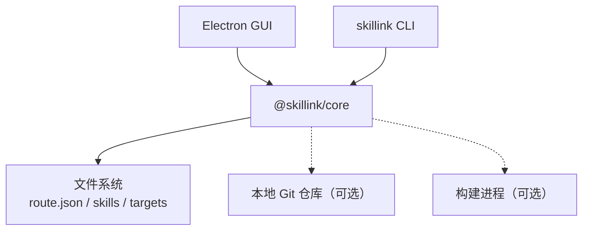
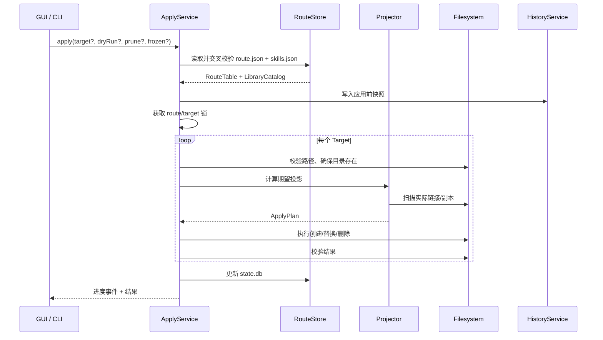

# Skillink 项目架构书

> **管理单位**：任意文件夹（Package），不要求 `SKILL.md`；Skill 只是可选特例。

> 文档版本：v1.2（架构基线）  
> 日期：2026-10-30  
> 状态：已确认（v1.2）  
> 项目目录：当前仓库根目录  
> 路径约定：`<user>`、`<repo>` 为占位符；Windows 全局路径使用 `%USERPROFILE%`，Linux/macOS 使用 `~`。  
> 变更记录：v1.1 将管理单位泛化为任意文件夹；MVP 来源仅本地文件夹；不要求 `SKILL.md`。v1.2 增加与 `route.json` 同级的 `skills.json`，用于管理公用库目录。

---

## 目录

1. [项目概述](#1-项目概述)
2. [术语与概念](#2-术语与概念)
3. [需求与约束](#3-需求与约束)
4. [架构原则](#4-架构原则)
5. [核心设计决策](#5-核心设计决策)
6. [总体架构](#6-总体架构)
7. [目录与数据布局](#7-目录与数据布局)
8. [route.json 与 skills.json 规范](#8-routejson-与-skillsjson-规范)
9. [核心流程](#9-核心流程)
10. [模块设计](#10-模块设计)
11. [数据模型](#11-数据模型)
12. [IPC 与 CLI](#12-ipc-与-cli)
13. [GUI 架构](#13-gui-架构)
14. [安全设计](#14-安全设计)
15. [跨平台设计](#15-跨平台设计)
16. [测试策略](#16-测试策略)
17. [部署与升级](#17-部署与升级)
18. [风险与对策](#18-风险与对策)
19. [迭代计划](#19-迭代计划)
20. [验收标准](#20-验收标准)
21. [已确认决策（v1.1）](#21-已确认决策v11)
22. [附录](#22-附录)

---

## 1. 项目概述

### 1.1 背景

项目数量增多后，本地文件夹/资源的管理会出现以下问题：

- 同一个文件夹在多个项目中重复复制；
- 不同项目里的同名文件夹版本不一致；
- 升级、回滚依赖手工复制，容易出错；
- 不知道某个文件夹被哪些目录使用；
- 删除旧版本时怕误删其他项目仍在使用的文件；
- 项目里散落各种副本，难以统一管理。

Skillink 的目标是提供一个**纯本地、中心化、pnpm 风格**的文件系统包管理器，通过全局版本库、统一路由文件和文件系统投影，解决**任意文件夹**的安装、链接、版本控制和清理问题。

Skill 只是其中一个典型使用场景：如果文件夹里包含 `SKILL.md`，它可以被识别为 Skill；但 Skillink 不要求、也不校验 `SKILL.md`。

### 1.2 产品定位

Skillink 是一个 **GUI 优先、CLI 辅助** 的本地文件夹包管理器：

- **中心化版本库**：所有包版本集中存放，不在项目里重复保存；
- **包是任意文件夹**：内容对工具不透明，不要求是 Skill 目录；
- **声明式路由**：一个全局 `route.json` 描述每个目标目录应包含哪些包、什么版本；
- **文件系统投影**：目标目录里只放链接或副本，不写 Skillink 配置；
- **单向控制**：`route.json` 是期望状态，目标目录是投影结果，不反向同步；
- **不绑定客户端**：目标目录由用户填写，工具不判断 OpenCode、Claude Code、Cursor 等客户端；
- **本地优先**：默认不联网、不上传、不登录。

### 1.3 核心目标

1. 一份内容只存一次，多个目标目录共享；
2. 每个目标目录拥有独立的包版本集合；
3. 安装结果可复现，支持离线 `apply --frozen`；
4. 支持更新、回滚、历史、审计；
5. 不污染项目根目录，不在项目中生成配置文件；
6. 不覆盖、不删除未托管内容；
7. Windows 优先，无需管理员权限；
8. GUI 能清楚展示路由、版本、链接状态和健康状态。

### 1.4 非目标

- 不做在线 Skill 市场；
- 不做 Agent 运行时，不执行 Skill 的提示词；
- 不为特定客户端做适配器，不猜测项目结构；
- 不重新实现 Git 的分支、合并、冲突解决；
- 不做 Skill 之间的依赖图解析；
- 不强制 Skill 目录结构，不要求或校验 `SKILL.md`；
- 不自动修改项目源码；
- MVP 不做文件级 CAS（作为后续内部优化）；
- MVP 不做远程同步和团队协作；
- MVP 来源仅支持用户选中本地文件夹，不支持 tar、Git、registry。

---

## 2. 术语与概念

| 术语 | 定义 |
|---|---|
| Package / Managed Folder | 用户选中的任意文件夹；内容对工具不透明，不要求是 Skill 目录 |
| Skill | Package 的一种常见特例：文件夹内含 `SKILL.md`；Skillink 只做可选元数据识别，不做强制校验 |
| Package Version | Package 的不可变快照，由名称、版本号、内容完整性共同确定 |
| 全局 Agent 根 | `%USERPROFILE%\.agents\`（Windows）；`~/.agents/`（Linux/macOS） |
| 全局发现库 | `%USERPROFILE%\.agents\skills\`，标准 Agent Skills 发现目录，可选 target |
| Skillink 控制面 | `%USERPROFILE%\.agents\skillink\`，存放路由、版本库、历史、缓存、日志 |
| 版本库 | `%USERPROFILE%\.agents\skillink\skills\<name>\<version>\`，Skillink 管理的不可变包目录；目录名沿用 `skills`，实际可存任意文件夹 |
| `route.json` | 路由配置，描述 target 到 package 的映射；JSON key 沿用 `skills` |
| `skills.json` | 公用库目录，描述版本库中可用的 Package/版本/完整性；与 `route.json` 同级 |
| Target | 用户指定的目录，其直接子项是受管 Package 文件夹；不要求是 Skill 目录 |
| Projection | Target 下的 Package 链接或副本 |
| Apply | 将 `route.json` 的期望状态收敛到 Target |
| Drift | Target 实际状态与 `route.json` 不一致 |
| Managed | 由 Skillink 创建和管理的链接/副本 |
| Unmanaged | 非 Skillink 创建的内容，工具不自动删除 |
| Version Boundary | 每个 Target 的 `skills{}` 集合，类似 pnpm 中一个项目的依赖集合 |
| Frozen | 只使用 `resolved` 版本，不重新解析版本范围 |

---

## 3. 需求与约束

### 3.1 功能需求

| 模块 | 需求 | 优先级 |
|---|---|---|
| 全局版本库 | 集中存放 `<name>/<version>/` 的任意文件夹包 | P0 |
| 公用库目录 | `skills.json` 记录所有可用 Package、版本、完整性、标签 | P0 |
| 路由 | 全局 `route.json`，target -> packages（JSON key 为 `skills`） | P0 |
| Target | 用户填写/选择任意目录路径 | P0 |
| 安装 | 从用户选中的本地文件夹导入任意文件夹；不要求 `SKILL.md` | P0 |
| 安装 | 用户输入包名/版本；默认文件夹名 / `0.0.0+<hash8>` | P0 |
| 安装 | 离线安装、`--frozen` | P0 |
| 链接 | 每个 Package 单独链接到 Target | P0 |
| 链接 | Windows junction、Linux/macOS symlink、copy 兜底 | P0 |
| 状态 | `status` 显示每个 Target/Package 的实际状态 | P0 |
| 健康检查 | `doctor` 检查断链、哈希、路径、路由 | P0 |
| 更新 | 按 Target 更新 Package 版本 | P1 |
| 回滚 | 从历史快照恢复路由并重新 apply | P1 |
| 历史 | 每次路由变更保存快照 | P1 |
| 快照 | 文件夹快照、哈希、文件清单；不校验 `SKILL.md` | P0 |
| 构建脚本 | 可选、显式信任后执行，超时、日志、环境白名单 | P1 |
| 清理 | GC 未引用版本，dry-run、保留期 | P1 |
| GUI | 路由、包库、存储、任务、设置 | P0 |
| CLI | 与 GUI 核心能力对等 | P0 |
| 导入 | 将已有 Target 中的真实文件夹导入版本库 | P1 |
| 多 Target | 同一 Package 可投影到多个 Target | P0 |
| 历史差异 | 版本间文件 diff；若存在 `SKILL.md`，可额外展示 | P2 |
| 本地 registry | 纯目录形式的本地发布/安装 | P2 |

### 3.2 非功能需求

| 维度 | 目标 |
|---|---|
| 本地优先 | 默认不联网；只有显式使用远程 Git 或检查更新时才联网 |
| 性能 | 100 个 Target、1000 个 Package 可流畅浏览；热 apply 10 个 Package < 1 秒 |
| 安全 | 不覆盖未托管内容；不默认执行脚本；防止路径穿越和链接攻击 |
| 可靠 | 崩溃后可恢复；不留下半链接状态；路由和版本库可校验 |
| 可移植 | `route.json` 可读、可 diff；路径支持 `~` 和后续变量 |
| 跨平台 | Windows 优先，Linux/macOS 后续适配 |
| 可维护 | Core 不依赖 Electron；GUI/CLI 共用核心 |
| 可观测 | 结构化日志、任务日志、诊断报告 |
| 体验 | 长任务可取消、进度可见、冲突有解释、危险操作需确认 |

### 3.3 关键约束

1. **不在项目里放配置**：项目根、Target 目录都不出现 `skillink.yaml`、`.skillink` 等文件。
2. **Target 路径由用户填写**：没有默认 `.agents/skills`，不猜测项目结构。
3. **`route.json` 是唯一配置源**：所有版本决策都在这里。
4. **目标目录只读投影**：工具只写 Target，不从 Target 反向读取配置。
5. **默认不删除**：未托管内容永不自动删除；`--prune` 只删除托管链接。
6. **包是任意文件夹**：不要求 `SKILL.md`，不校验 Skill 规范；包名只要求是安全的文件夹名。
7. **MVP 来源仅本地文件夹**：用户通过文件夹选择器导入；tar、Git、registry 后续支持。
8. **已安装 Package 不可变**：修改包内容要走源文件夹重新导入，或使用后续的 dev 流程，不能直接改版本库。
9. **默认不执行构建脚本**：首次运行必须显式信任。
10. **Windows 优先**：junction、路径长度、中文路径、杀毒软件占用都要覆盖。

---

## 4. 架构原则

1. **配置职责分离**：`route.json` 管目标路由，`skills.json` 管公用库；两者都做 schema 校验和交叉校验，不维护第三份配置。
2. **声明式收敛**：`apply` 计算差异并收敛 Target，不依赖命令式脚本。
3. **Target 是投影，不是配置**：Target 的现状只用于诊断，不用于决定版本。
4. **版本不可变**：版本库中的 `<name>/<version>/` 写入后只读；变更必须产生新版本。
5. **包内容不透明**：Package 是任意文件夹，工具只做快照、哈希、链接，不解释内容；`SKILL.md` 只是可选元数据。
6. **永不删除未托管内容**：只删除可证明由 Skillink 管理的链接或副本。
7. **Core 与 UI 分离**：Core 不依赖 Electron，CLI/GUI 共用同一套服务。
8. **文件系统即接口**：Target 是一个普通目录；工具不关心谁读取它。
9. **本地优先**：默认离线，所有状态在本地文件系统中。

---

## 5. 核心设计决策

| ID | 决策 | 理由 | 影响 |
|---|---|---|---|
| D1 | 中心 `%USERPROFILE%\.agents\skillink\route.json`，项目无配置 | 多项目统一管理；不污染项目 | 单点配置，需要备份、锁、历史 |
| D2 | `route.json` 采用 `target -> packages`（JSON key 沿用 `skills`） | 版本边界在 Target；查询/apply 简单 | 不维护 package -> targets 反向索引 |
| D3 | 版本库放 `%USERPROFILE%\.agents\skillink\skills\<name>\<version>\`，可存任意文件夹 | 保留既有路径和标准发现布局 | 需要投影层；目录名 `skills` 只是历史命名 |
| D4 | Target 路径用户填写 | 不绑定客户端和项目结构 | 必须做路径安全校验 |
| D5 | 每个 Package 单独链接，不整目录 junction | 可与未托管文件夹共存；可单独更新 | Target 中链接数量较多 |
| D6 | 单向声明式收敛 | `route.json` 是期望状态，Target 是投影 | 不反向同步；漂移需 `status/doctor` |
| D7 | 已安装 Package 不可变 | 保证版本库和完整性 | 编辑走源文件夹重新导入/dev |
| D8 | 构建脚本默认禁用 | 避免任意代码执行 | 首次信任提示、超时、日志 |
| D9 | MVP 包级去重，V1 文件级 CAS | 控制复杂度 | `route.json` 和 `skills/` 结构不变 |
| D10 | Core 不依赖 Electron | CLI/GUI 复用、易测试 | 需要端口抽象 |
| D11 | MVP 来源仅本地文件夹 | 用户要求；降低复杂度 | tar/Git/registry 后置 |
| D12 | 不要求、不校验 `SKILL.md` | 面向文件系统，包是任意文件夹 | 仅做可选元数据识别 |
| D13 | 版本号用户输入，缺省 `0.0.0+<hash8>` | 任意文件夹不一定有版本 | 语义化版本仍是推荐值 |
| D14 | `skills.json` 管理公用库，与 `route.json` 同级 | 版本库需要独立目录；路由只引用使用中的版本 | 两文件需交叉校验 |
| D15 | 先写版本内容，再原子更新 `skills.json` | 先有内容后有索引，崩溃可恢复 | 可能出现孤儿目录，由 `doctor` 修复 |

---

## 6. 总体架构

### 6.1 系统上下文



### 6.2 分层架构

```text
┌─────────────────────────────────────────────┐
│ Renderer（sandboxed React）                  │
│ 页面、表格、表单、任务进度                    │
└──────────────────┬──────────────────────────┘
                   │ typed IPC
┌──────────────────▼──────────────────────────┐
│ Preload                                     │
│ 白名单 API、事件转发                         │
└──────────────────┬──────────────────────────┘
                   │
┌──────────────────▼──────────────────────────┐
│ Electron Main                               │
│ 窗口、菜单、对话框、IPC 路由、单实例          │
└──────────────────┬──────────────────────────┘
                   │
┌──────────────────▼──────────────────────────┐
│ Application Services                        │
│ Route / Target / Package / Apply / Doctor    │
│ Build / History / GC / Task                 │
└──────────────────┬──────────────────────────┘
                   │
┌──────────────────▼──────────────────────────┐
│ Domain                                      │
│ RouteTable / TargetRoute / PackageLock      │
│ Version / Integrity / Link / Drift          │
│ PathPolicy / LinkPolicy / TrustPolicy       │
└──────────────────┬──────────────────────────┘
                   │ Ports
┌──────────────────▼──────────────────────────┐
│ Infrastructure                              │
│ Node FS / junction / symlink / SQLite       │
│ archive / child_process / simple-git / logger│
└─────────────────────────────────────────────┘
```

**依赖规则**

- Renderer 不直接访问 Node/文件系统；
- Main 和 CLI 都依赖 Core；
- Core 不 import Electron；
- Infrastructure 实现 Core 定义的端口；
- 所有跨进程数据用 zod 校验。

### 6.3 进程模型

```text
Electron Main（唯一写入者）
├─ 任务队列
├─ route.json 文件锁
├─ Target 锁
├─ SQLite（WAL）
├─ worker_threads：扫描、哈希、归档
└─ child_process：构建脚本、Git
```

- 主进程是唯一写入者，避免并发修改 `route.json` 和 Target；
- 重 I/O 和哈希放 worker；
- 构建脚本、Git 用子进程，禁用 shell 拼接；
- 单实例锁，第二次启动聚焦已有窗口；
- 所有长任务支持取消，子进程 kill 进程树。

### 6.4 源码目录

```text
skillink/
├─ apps/
│  ├─ desktop/
│  │  └─ src/{main,preload,renderer}/
│  └─ cli/
├─ packages/
│  ├─ core/          # 领域 + 应用服务 + 端口
│  ├─ store/         # 版本库、链接、GC（MVP 可并入 core）
│  ├─ build/         # 快照、可选构建运行器
│  └─ shared/        # 类型、zod schema、错误码、IPC 契约
├─ fixtures/         # 测试包、冲突场景、恶意源文件夹
└─ docs/
```

MVP 可以先把 `store`、`build` 合并到 `core`，但目录边界保持，方便后续拆包。

---

## 7. 目录与数据布局

### 7.1 全局目录

Windows：

```text
%USERPROFILE%\.agents\
├─ skills\                              # 标准发现目录（可选 target）
│  ├─ pdf -> ..\skillink\skills\pdf\1.2.0
│  └─ review -> ..\skillink\skills\review\2.0.0
│
└─ skillink\                            # Skillink 控制面
   ├─ route.json                        # 路由
   ├─ skills.json                       # 公用库目录
   ├─ skills\                           # 版本库
   │  ├─ pdf\
   │  │  ├─ 1.2.0\
   │  │  │  ├─ README.md
   │  │  │  └─ ...
   │  │  └─ 1.3.0\
   │  │     ├─ README.md
   │  │     └─ ...
   │  └─ review\
   │     └─ 2.0.0\
   │        ├─ README.md
   │        └─ ...
   ├─ history\
   │  └─ 2026-10-30T12-00-00-000Z\
   │     ├─ route.json
   │     └─ skills.json
   ├─ cache\
   │  ├─ builds\<hash>\
   │  └─ tmp\
   ├─ logs\
   └─ state.db
```

Linux/macOS：

```text
~/.agents/
├─ skills/
└─ skillink/
   ├─ route.json
   ├─ skills.json
   ├─ skills/
   ├─ history/
   ├─ cache/
   ├─ logs/
   └─ state.db
```

**说明**

- 版本目录的内容完全由用户选中的文件夹决定；`README.md` 只是示例，`SKILL.md` 可选，不是安装前提。
- `~/.agents/skills/` 是 Agent Skills 标准发现目录，但**不是默认 target**；用户需要时才把它加入 `route.json`。
- `~/.agents/skillink/skills/` 是 Skillink 自己的多版本库。
- `~/.agents/skillink/route.json` 是路由配置源，描述每个 Target 使用哪些 Package/版本。
- `~/.agents/skillink/skills.json` 是公用库目录源，描述版本库中有哪些 Package/版本；它只记录“可用”，不表示“已分配”。
- `route.json` 和 `skills.json` 需要交叉校验：路由引用的版本必须存在于公用库目录。
- `state.db` 是运行时索引和状态，不是配置源；可重建。
- 支持 `SKILLINK_HOME` 环境变量覆盖 `~/.agents/skillink`，便于测试和便携使用。

### 7.2 Target 目录

Target 是用户填写的、直接包含受管 Package 文件夹的目录。名字和位置完全由用户决定，不要求目录叫 `skills`，也不要求内容是 Skill。例如：

```text
C:\Projects\ProjectA\packages\         # 用户填写
├─ pdf     -> %USERPROFILE%\.agents\skillink\skills\pdf\1.2.0
└─ review  -> %USERPROFILE%\.agents\skillink\skills\review\2.0.0
```

也可以是：

```text
D:\Work\SomeProject\.agents\skills\
D:\Shared\team-skills\
%USERPROFILE%\.agents\skills\
```

工具不推断项目根，不自动拼接 `.agents/skills`，不在 Target 中生成任何配置文件。

### 7.3 路径规则

- Target `path` 必填，必须是本地绝对路径或 `~` / `%USERPROFILE%` 开头；
- JSON 中推荐使用 `/`，运行时转换为平台路径；
- 解析后使用 `realpath` 规范化；
- 拒绝盘符根目录、系统目录、用户主目录根、Skillink 控制面内部路径；
- 拒绝 Target 之间的嵌套/重叠；
- Windows 大小写不敏感，需做冲突检测；
- 网络路径、可移动磁盘给出警告，默认不启用；
- `route.json` 默认是本机文件，不假设跨机器同步；后续可加 `${HOME}`、`${PROJECTS}` 变量。

---

## 8. route.json 与 skills.json 规范

### 8.1 完整示例

```json
{
  "schemaVersion": 1,
  "targets": [
    {
      "id": "project-a",
      "label": "Project A",
      "path": "C:/Projects/ProjectA/packages",
      "mode": "link",
      "enabled": true,
      "skills": {
        "pdf": {
          "requested": "^1.2.0",
          "resolved": "1.2.0",
          "integrity": "sha512-...",
          "source": "skills/pdf/1.2.0",
          "enabled": true,
          "build": {
            "built": false
          }
        },
        "review": {
          "requested": "2.0.0",
          "resolved": "2.0.0",
          "integrity": "sha512-...",
          "source": "skills/review/2.0.0",
          "enabled": true
        }
      }
    },
    {
      "id": "project-b",
      "label": "Project B",
      "path": "D:/Work/ProjectB/packages",
      "mode": "copy",
      "enabled": true,
      "skills": {
        "pdf": {
          "requested": "^1.3.0",
          "resolved": "1.3.0",
          "integrity": "sha512-...",
          "source": "skills/pdf/1.3.0",
          "enabled": true
        }
      }
    }
  ]
}
```

### 8.2 字段说明

> 说明：`targets[].skills` 是历史命名，语义是“受管 Package 映射”。Package 可以是任意文件夹，不要求是 Skill。

| 字段 | 必填 | 说明 |
|---|---|---|
| `schemaVersion` | 是 | 当前为 1；用于迁移 |
| `targets` | 是 | Target 数组，数组顺序稳定 |
| `targets[].id` | 是 | 稳定唯一 ID，用于 CLI/GUI 引用 |
| `targets[].label` | 否 | GUI 显示名，不参与逻辑 |
| `targets[].path` | 是 | 用户填写的目标目录 |
| `targets[].mode` | 是 | `link` 或 `copy` |
| `targets[].enabled` | 否 | 默认 true；false 时 `apply` 跳过 |
| `targets[].skills` | 是 | Package 名称到版本信息的映射 |
| `skills[].requested` | 否 | 版本范围、精确版本或 `skills.json` 标签；缺省时使用 `resolved` |
| `skills[].resolved` | 是 | 精确版本，`apply --frozen` 使用 |
| `skills[].integrity` | 是 | 内容完整性，例如 `sha512-...` |
| `skills[].source` | 是 | 版本库内相对路径，例如 `skills/pdf/1.2.0` |
| `skills[].enabled` | 否 | 默认 true；false 时不投影 |
| `skills[].build` | 否 | 可选构建信息，记录是否构建、构建哈希 |

### 8.3 约束

- `targets[].id` 唯一；
- `targets[].path` 唯一，且不能互相嵌套；
- Package 名称必须是安全的文件夹名：不能包含路径分隔符、Windows 保留名、结尾空格/点；建议使用字母、数字、`-`、`_`、`.`，允许中文；
- `resolved` 必须是精确版本或 `0.0.0+<hash>` 形式；
- `integrity` 必须与版本库中的包一致；
- `route.json` 不存时间戳、任务状态、链接健康状态等运行时数据；
- `skills` 的 key 排序稳定，保证 diff 干净；
- 写入前用 zod + JSON Schema 校验；
- 写入采用“临时文件 + rename”，并保留历史快照。

### 8.4 版本语义

- `requested` 表示用户意图，例如 `^1.2.0`、`~1.2.0`、`1.2.0`；
- `requested` 也可以引用 `skills.json` 中的 tag，例如 `latest`，解析为 tag 对应的精确版本；
- `resolved` 表示实际锁定版本；
- `update` 在 `requested` 范围内选择新版本并更新 `resolved`；
- `pin` 把 `resolved` 写死，可选清空 `requested`；
- `apply --frozen` 只使用 `resolved`，不重新解析；
- 同一 `name@version` 内容不同：拒绝覆盖，要求升版本或使用 `+build` 元数据；
- 导入时用户可指定版本；留空则自动使用 `0.0.0+<hash8>`；
- 非 semver 来源可使用 `0.0.0+<hash8>`，但必须唯一。

### 8.5 skills.json（公用库目录）

`skills.json` 与 `route.json` 同级，负责管理**公用库**。这里的公用库指本机中央版本库，不是网络共享仓库：

- 库里有哪些 Package；
- 每个 Package 有哪些版本；
- 每个版本的内容完整性、文件数、大小、来源、构建信息；
- 可选的标签，例如 `latest`、`stable`；
- 可选的展示元数据，例如从 `SKILL.md` 读取的 name/description。

示例：

```json
{
  "schemaVersion": 1,
  "packages": {
    "pdf": {
      "description": "PDF tools",
      "kind": "skill",
      "tags": {
        "latest": "1.3.0",
        "stable": "1.2.0"
      },
      "versions": {
        "1.2.0": {
          "integrity": "sha512-...",
          "source": "skills/pdf/1.2.0",
          "fileCount": 42,
          "size": 184320,
          "built": false,
          "metadata": {
            "name": "pdf",
            "description": "PDF tools"
          }
        },
        "1.3.0": {
          "integrity": "sha512-...",
          "source": "skills/pdf/1.3.0",
          "fileCount": 45,
          "size": 191232,
          "built": false
        }
      }
    },
    "review": {
      "kind": "folder",
      "versions": {
        "2.0.0": {
          "integrity": "sha512-...",
          "source": "skills/review/2.0.0",
          "fileCount": 12,
          "size": 48120,
          "built": false
        }
      }
    }
  }
}
```

字段说明：

| 字段 | 必填 | 说明 |
|---|---|---|
| `schemaVersion` | 是 | 当前为 1；用于迁移 |
| `packages` | 是 | Package 名称到库信息的映射 |
| `packages[].description` | 否 | GUI 展示用描述 |
| `packages[].kind` | 否 | `folder` / `skill` / `unknown`；不参与安装决策 |
| `packages[].tags` | 否 | 标签到精确版本的映射，例如 `latest: "1.3.0"` |
| `packages[].versions` | 是 | 精确版本到版本信息的映射 |
| `versions[].integrity` | 是 | 内容完整性，例如 `sha512-...` |
| `versions[].source` | 是 | 版本库内相对路径，例如 `skills/pdf/1.2.0` |
| `versions[].fileCount` | 是 | 文件数量 |
| `versions[].size` | 是 | 总字节数 |
| `versions[].built` | 否 | 是否经过可选构建 |
| `versions[].metadata` | 否 | 可选展示元数据；不参与校验 |

约束：

- `skills.json` 只描述“库里有什么”，不描述“哪个 Target 用了什么”；
- `route.json` 只描述“哪个 Target 用了什么”，不重复记录库的完整版本清单；
- `skills.json` 中可以有未被任何 Target 引用的版本，用于回滚和历史；
- `tags` 必须指向已存在的版本；
- `source` 必须对应 `skills/<name>/<version>/` 目录；
- `skills.json` 不存链接状态、任务状态、时间戳等运行时数据；
- `packages`、`versions`、`tags` 的 key 排序稳定，保证 diff 干净；
- 写入前用 zod + JSON Schema 校验，原子写入并保留历史快照。

### 8.6 route.json 与 skills.json 的关系

```text
skills.json                   route.json
公用库目录                     目标路由
“库里有 pdf@1.2.0, 1.3.0”      “Project A 用 pdf@1.2.0”
        │                            │
        └──────────┬─────────────────┘
                   ▼
          skills/pdf/1.2.0/ 内容
```

| 文件 | 职责 | 是否包含未使用版本 | 是否包含 Target |
|---|---|---|---|
| `skills.json` | 公用库目录 | 是 | 否 |
| `route.json` | 目标路由 | 否（只列引用） | 是 |
| `skills/` | 不可变内容 | 是 | 否 |
| `state.db` | 运行时状态 | 可缓存 | 可缓存 |

**交叉校验规则**

- `route.json` 中每个 `resolved` 必须存在于 `skills.json`；
- `route.json` 中每个 `integrity` 必须与 `skills.json` 一致；
- `route.json` 中 `source` 必须指向 `skills.json` 中同一版本；
- `skills.json` 中每个 `source` 目录必须存在；
- `skills.json` 中每个版本的完整性必须与目录内容一致；
- `skills.json` 中未被 route 引用的版本是合法的，GC 时才考虑清理。

### 8.7 写入顺序与一致性

1. 导入新版本时，先写入临时目录，计算哈希；
2. 将内容目录原子移动到 `skills/<name>/<version>/`；
3. 原子更新 `skills.json`；
4. 如果新版本要立即分配给 Target，再更新 `route.json`；
5. 每次修改前，把 `route.json` 和 `skills.json` 一起快照到 `history/<timestamp>/`；
6. 崩溃恢复时：
   - 内容存在但 `skills.json` 无记录：孤儿目录，`doctor` 可导入或移入 `trash/`；
   - `skills.json` 有记录但内容缺失：损坏条目，`doctor` 标记，`apply` 拒绝使用；
   - `route.json` 引用不存在于 `skills.json` 的版本：`apply` 拒绝，提示修复；
7. 两个文件都使用临时文件 + rename，并加文件锁；
8. 恢复历史时，`route.json` 与 `skills.json` 必须成对恢复，避免交叉引用断裂。

---

## 9. 核心流程

### 9.1 导入本地文件夹到版本库

```text
用户选择一个本地文件夹
        │
        ▼
校验路径、文件数、大小、符号链接策略
        │
        ▼
询问包名 / 版本（默认：文件夹名 / 0.0.0+<hash8>）
        │
        ▼
复制到临时目录，计算文件哈希 + 生成 manifest
        │
        ▼
可选：读取 SKILL.md frontmatter 作为展示元数据
        │
        ▼
写入 ~/.agents/skillink/skills/<name>/<version>/
        │
        ▼
原子更新 skills.json（公用库目录）
        │
        ▼
设为只读、记录 state.db
```

规则：

- **MVP 来源仅本地文件夹**：通过文件夹选择器选中，不支持 tar、Git、registry；
- **不要求 `SKILL.md`**：文件夹内容对工具不透明，可以是任意文件、目录、项目片段、资源包；
- **可选元数据**：如果存在 `SKILL.md`，可解析 frontmatter 的 `name` / `description` 用于 GUI 展示，但不参与安装决策、不做规范校验；
- 包名默认取文件夹名，用户可修改；必须是安全的文件夹名；
- 版本号用户可输入；留空则自动使用 `0.0.0+<hash8>`；
- 保留空目录、隐藏文件和普通文件；MVP 不自动排除 `.git`、`node_modules` 等目录；
- 包内符号链接 MVP 直接拒绝；后续可提供 `--allow-symlinks`；
- 版本目录不可变；
- 同版本已存在且哈希一致：复用；
- 同版本已存在但哈希不同：拒绝；
- 导入只更新 `skills.json`，不自动修改 `route.json`；
- 导入后还需要在 `route.json` 中分配给 Target，或通过 `route add` 一步完成。

### 9.2 Apply / Reconcile



**执行规则**

1. 读取并校验 `route.json` 与 `skills.json`；任一无效或交叉引用失败则拒绝 apply；
2. 获取 `route.json` 全局锁和 Target 锁；
3. 对每个启用的 Target：
   - 解析并校验路径；
   - 目录不存在时询问是否创建；
   - 计算期望的 Package 集合；
   - 扫描 Target 中的实际内容；
   - 生成计划：创建、替换、跳过、冲突、删除；
   - `--dry-run` 时只输出计划；
   - 执行时使用临时链接 + rename，失败按日志回滚；
4. `--prune` 只删除托管链接/副本，不删除未托管内容；
5. `--frozen` 只使用 `resolved`，并校验包存在、哈希一致；
6. 写入 `state.db` 和任务日志；
7. 失败时保持 `route.json` 不变，`status` 显示漂移。

**冲突处理**

| 情况 | 行为 |
|---|---|
| Target 路径不存在 | 询问是否创建 |
| Package 路径不存在 | 创建链接/副本 |
| 已有托管链接，版本正确 | 跳过 |
| 已有托管链接，版本不同 | 原子替换 |
| 已有托管链接，目标损坏 | 报错并建议修复 |
| 已有真实目录，同名 | 冲突，不覆盖；提供跳过/导入/改名 |
| 已有未托管符号链接 | 冲突，不覆盖 |
| Target 是文件而非目录 | 报错 |
| Target 嵌套/重叠 | 拒绝 apply |

### 9.3 Status / Doctor

**Status** 输出每个 Target/Package 的状态：

```text
ok | missing | wrong-version | broken-link | conflict | unmanaged | extra | disabled
```

**Doctor** 检查：

- `route.json` schema、重复 ID、重复路径、嵌套路径；
- `skills.json` schema、失效 tag、重复版本、source 路径；
- `route.json` 引用的版本是否存在于 `skills.json`，integrity 是否一致；
- `skills.json` 与 `skills/` 目录是否一一对应：缺失条目、孤儿目录；
- 版本库目录是否存在、是否可读；
- 包完整性是否匹配 `integrity`；
- Target 是否存在、是否可写；
- 托管链接是否指向版本库；
- 链接是否损坏；
- 是否有未托管同名内容；
- 是否有版本库中未被引用的版本；
- 是否有 Target 不再被 route 引用。

`doctor --fix` 只修复安全项：重建断链、修正托管链接、清理临时文件；不删除未托管内容。

### 9.4 更新与回滚

**更新**

```text
route.json 中 requested 范围
        │
        ▼
解析可用版本（版本库）
        │
        ▼
选择新 resolved
        │
        ▼
写 route.json 历史快照
        │
        ▼
apply --target <id>
```

- `update --target project-a` 只更新一个 Target；
- `update --all` 更新所有 Target；
- 默认遵守 `requested` 范围；
- `--latest` 可以跳到范围外，但需要确认；
- 更新失败时 route 仍是期望状态，status 显示 mismatch。

**回滚**

- 从 `history/<timestamp>/` 选择快照；
- 同时恢复快照中的 `route.json` 和 `skills.json`；
- 校验快照引用的版本目录；缺失时优先从 `trash/` 恢复内容，无法恢复则拒绝回滚并保持当前配置不变；
- 恢复 `targets[].skills` 的版本信息；
- 执行 `apply --target`；
- 可选生成新的历史快照，保留审计链。

### 9.5 可选构建

构建不是安装的必要步骤。任意文件夹可以直接快照；只有用户显式配置了构建命令时才执行。

```text
源文件夹
  → 复制到临时目录
  → 路径安全 / 可选元数据识别
  → 可选 build（显式信任）
  → 生成确定性快照
  → 写入版本库
```

构建安全：

> MVP 只做文件夹快照；构建脚本在 P1 开放。

- 默认禁用；
- 首次执行展示来源、命令、工作目录、环境变量；
- 子进程运行，禁用 shell；
- 超时、输出上限、环境变量白名单；
- 失败不写入版本库；
- 记录信任规则，后续同命令可复用；
- Windows 下无轻量沙箱，构建脚本仍按不可信代码对待。

### 9.6 GC

1. 获取全局锁；
2. 扫描 `route.json` 中所有 Target，收集引用的 `name@version`；
3. 扫描版本库；
4. 未被引用的版本进入候选；
5. 保留期（默认 7 天）内的版本不删；
6. 确认没有 Target 链接指向候选版本；
7. 从 `skills.json` 删除对应条目，再移入 `trash/`，支持短期撤销；
8. 输出释放空间和删除列表；
9. 支持 `--dry-run`。

### 9.7 导入已有 Target

用于接管已有目标目录中的真实文件夹：

1. 扫描用户指定的 Target；
2. 识别其中的真实文件夹（`SKILL.md` 只作为可选元数据，不要求存在）；
3. 读取名称、版本、文件清单；
4. 复制到版本库；
5. 生成 `route.json` 条目；
6. 用户确认后，将原文件夹替换为托管链接；
7. 不删除原文件夹，先移到 `trash/` 或保留备份。

---

## 10. 模块设计

### 10.1 应用服务

| 服务 | 职责 |
|---|---|
| `RouteService` | 读取、校验、修改 `route.json`，历史快照 |
| `LibraryService` | 读取、校验、修改 `skills.json`，登记版本、标签、交叉校验 |
| `TargetService` | 添加、删除、校验 Target，路径安全 |
| `PackageService` | 导入本地文件夹、生成快照、删除版本库中的包 |
| `ApplyService` | 计算计划、执行投影、回滚 |
| `StatusService` | 对比 route 与实际，输出状态 |
| `DoctorService` | 完整性、路径、链接、路由检查 |
| `BuildService` | 可选构建、快照缓存 |
| `HistoryService` | 快照、列表、回滚 |
| `GcService` | 标记-清除未引用版本 |
| `TrustService` | 构建脚本信任规则 |
| `TaskService` | 任务队列、进度、取消、日志 |

### 10.2 领域对象

```text
RouteTable
  └─ TargetRoute[]
       ├─ id / label / path / mode / enabled
       └─ PackageLock[]
            ├─ name
            ├─ requested / resolved
            ├─ integrity / source
            └─ build

LibraryCatalog
  └─ packages[]
       ├─ name / description / kind
       ├─ tags
       └─ versions[]
            ├─ version
            ├─ integrity / source
            ├─ fileCount / size
            └─ built / metadata

ManagedPackage
  ├─ name
  ├─ version
  ├─ integrity
  ├─ files[]
  ├─ sourceFolder
  └─ optional metadata

Projection
  ├─ targetId
  ├─ skillName
  ├─ version
  ├─ path
  ├─ type: junction | symlink | copy
  └─ state: ok | broken | conflict

ApplyPlan
  ├─ creates[]
  ├─ replaces[]
  ├─ removes[]
  └─ conflicts[]
```

### 10.3 端口

| 端口 | 作用 |
|---|---|
| `RouteRepository` | 读写 `route.json` |
| `LibraryRepository` | 读写 `skills.json` |
| `PackageRepository` | 管理版本库内容目录 |
| `FileSystemPort` | 文件操作、realpath、只读 |
| `LinkPort` | junction / symlink / copy |
| `HashPort` | SHA-512、manifest 哈希 |
| `ArchivePort` | tar/zip 打包/解包（后续来源） |
| `ProcessPort` | 构建脚本、Git |
| `DatabasePort` | SQLite |
| `LoggerPort` | 结构化日志 |
| `ClockPort` | 时间，便于测试 |

### 10.4 基础设施

- Node `fs/promises`；
- Windows `fs.symlink(target, path, 'junction')`；
- Linux/macOS symlink；
- copy / CoW 兜底；
- `node:sqlite`（封装，必要时切 `better-sqlite3`）；
- `tar`（后续归档来源）；
- `simple-git` + 系统 Git；
- `child_process.spawn`；
- `electron-log`。

---

## 11. 数据模型

`state.db` 是运行时索引和状态；`route.json` 与 `skills.json` 是配置源。数据库丢失后，可从这两个文件、版本库目录和 Target 扫描重建。

> 数据库中的 `package` 指任意受管文件夹；`route.json` 的 JSON key 仍沿用 `skills`，语义相同。`packages` / `package_versions` 表可视为 `skills.json` 的查询缓存。

| 表 | 主要字段 | 作用 |
|---|---|---|
| `targets` | id, label, path, mode, enabled, last_applied_at | Target 缓存 |
| `packages` | name, description, kind | Package 元数据；`kind` 可为 folder/skill/unknown |
| `package_versions` | id, package_name, version, integrity, manifest_hash, size, file_count, built, created_at | 版本库索引 |
| `package_files` | version_id, path, integrity, mode, size | 文件清单 |
| `projections` | target_id, package_name, version_id, path, link_type, state, updated_at | 实际投影状态 |
| `history` | id, snapshot_path, reason, created_at | 路由历史 |
| `tasks` | id, type, status, progress, error, log_path, started_at, finished_at | 任务记录 |
| `trust_rules` | id, source_pattern, command_hash, decision, created_at | 构建信任 |
| `settings` | key, value | 应用设置 |

SQLite 配置：

- WAL 模式；
- `foreign_keys=ON`；
- `busy_timeout=5000`；
- 迁移脚本版本化；
- 单写入者（Main）。

---

## 12. IPC 与 CLI

### 12.1 IPC 契约

```ts
type Result<T> =
  | { ok: true; data: T }
  | { ok: false; error: AppError };

interface SkillinkApi {
  route: {
    get(): Promise<Result<RouteTable>>;
    update(patch: RoutePatch): Promise<Result<RouteTable>>;
    history(): Promise<Result<HistoryEntry[]>>;
  };
  library: {
    get(): Promise<Result<LibraryCatalog>>;
    tag(name: string, version: string, tag: string): Promise<Result<void>>;
    remove(name: string, version: string): Promise<Result<TaskId>>;
  };
  target: {
    list(): Promise<Result<TargetInfo[]>>;
    add(input: AddTargetInput): Promise<Result<TargetInfo>>;
    remove(id: string): Promise<Result<void>>;
  };
  package: {
    list(): Promise<Result<PackageInfo[]>>;
    import(input: ImportInput): Promise<Result<TaskId>>;
    build(name: string, version: string): Promise<Result<TaskId>>;
  };
  apply(request: ApplyRequest): Promise<Result<TaskId>>;
  status(request?: StatusRequest): Promise<Result<StatusReport>>;
  doctor(request?: DoctorRequest): Promise<Result<DiagnosisReport>>;
  gc(request: GcRequest): Promise<Result<TaskId>>;
  task: {
    get(id: string): Promise<Result<TaskSnapshot>>;
    cancel(id: string): Promise<Result<void>>;
    onProgress(cb: (event: TaskEvent) => void): () => void;
  };
}
```

规则：

- 所有入参、出参 zod 校验；
- 不暴露通用 `invoke(channel, ...args)`；
- 主进程校验 sender URL；
- 返回 `Result`，不把堆栈直接抛给 UI；
- 长任务通过事件推送进度。

### 12.2 CLI 命令

```bash
skillink init
skillink target add <path> [--label <name>]
skillink target list
skillink target remove <id>

skillink add <folder> [--name <name>] [--version <version>]
skillink list
skillink library list
skillink library tag <name>@<version> <tag>
skillink library remove <name>@<version>
skillink build <name>@<version>
skillink retag <name>@<version> <new-version>

skillink route add <target-id> <package>@<range>
skillink route update <target-id> <package>@<range>
skillink route remove <target-id> <package>

skillink apply [--target <id>] [--dry-run] [--prune] [--frozen]
skillink status [--json]
skillink doctor [--fix]
skillink update [--target <id>] [--all]
skillink rollback <target-id> [--to <snapshot>]
skillink history
skillink gc [--dry-run]
skillink import <folder> [--name <name>] [--version <version>] [--target <id>]
```

退出码：

- `0` 成功；
- `1` 一般错误；
- `2` 参数错误；
- `3` 冲突/需要人工处理；
- `4` 完整性失败；
- `5` 锁占用。

---

## 13. GUI 架构

### 13.1 页面

| 页面 | 内容 |
|---|---|
| 总览 | 版本库大小、Target 数、可更新项、健康告警 |
| 路由 / Targets | Target 列表、路径、模式、Package 版本矩阵、apply/status |
| 包库 | 读取 `skills.json`：所有 `name@version`、标签、来源、被哪些 Target 使用、构建状态 |
| 存储 | 版本库大小、未使用版本、GC、完整性检查 |
| 任务 | 进行中/历史任务、进度、日志、取消、重试 |
| 历史 | route 快照、差异、回滚 |
| 设置 | `SKILLINK_HOME`、默认链接模式、历史保留、信任规则、主题/语言 |

### 13.2 关键交互

- **导入 Package**：文件夹选择器；用户选择任意文件夹，填写包名/版本；不要求 `SKILL.md`；
- **添加 Target**：文件夹选择器；路径必填；没有默认值；提示“请选择直接包含包文件夹的目录”；
- **Target 详情**：Package 表格、当前版本、可用版本、链接状态、冲突；
- **Apply**：先 dry-run 展示计划；冲突必须人工选择；
- **更新**：按 Target 选择版本；显示影响范围；
- **回滚**：选择历史快照；预览将要变化的 Target；
- **GC**：显示将删除的版本和释放空间；默认 dry-run；
- **Doctor**：分组显示错误、警告、可修复项。

### 13.3 技术栈

- React 19 + TypeScript；
- Tailwind CSS 4 + shadcn/ui + Radix；
- TanStack Query（IPC 数据）；
- Zustand（UI 状态）；
- TanStack Table + Virtual；
- React Hook Form + zod；
- HashRouter；
- `react-markdown` + sanitize；
- `cmdk` 命令面板；
- `electron-log` 日志查看。

### 13.4 UX 原则

- 不覆盖、不删除未托管内容；
- 危险操作二次确认；
- 删除进 `trash/`，支持撤销；
- 长任务后台运行，不阻塞窗口；
- 错误信息说明“发生了什么、为什么、下一步”；
- 路径和版本都用可复制文本展示；
- 支持键盘操作和命令面板。

---

## 14. 安全设计

| 威胁 | 对策 |
|---|---|
| 恶意压缩包路径穿越（tar 后续支持） | 拒绝绝对路径、`..`；限制文件数/大小；提取后 realpath 校验 |
| 导入文件夹路径异常 | 规范化选中路径；拒绝系统目录；限制文件数/大小；不自动跟随 junction |
| 符号链接攻击 | 包内符号链接 MVP 拒绝；写入用 `lstat`；不跟随未知链接 |
| Target 路径误填 | 拒绝系统目录、盘符根、主目录根、控制面内部；二次确认 |
| 删除未托管内容 | 只删除托管链接/带标记副本；默认不 prune |
| 构建脚本 | 默认禁用；显式信任；子进程；超时；输出上限；环境白名单 |
| 版本库被篡改 | 只读；integrity 校验；`doctor` 全量检查；权限收紧 |
| route.json / skills.json 损坏 | schema 校验；原子写；成对备份；历史快照；交叉校验 |
| skills.json 与版本目录不一致 | `doctor` 检查缺失条目/孤儿目录；`apply` 拒绝不完整引用 |
| Renderer XSS | `contextIsolation`、`sandbox`、`nodeIntegration: false`、CSP、Markdown sanitize |
| IPC 滥用 | 白名单 API、zod、sender 校验、不暴露文件系统原语 |
| 外部链接 | 阻止导航；外链确认；`shell.openExternal` 仅 http/https |
| 自动更新 | 代码签名；HTTPS；无签名提供手动更新 |

Electron 基线：

```ts
webPreferences: {
  contextIsolation: true,
  sandbox: true,
  nodeIntegration: false,
  webSecurity: true,
}
```

同时设置 CSP、拒绝新窗口、阻止导航、权限请求默认拒绝。

---

## 15. 跨平台设计

### 15.1 Windows

- 目录链接默认 junction，无需管理员权限；
- 版本库在 C 盘，Target 可在其他盘，junction 跨卷指向版本库；
- 处理长路径、中文路径、空格、OneDrive、Defender 文件锁；
- 大小写不敏感，Package 名称需做大小写冲突检测；
- 文件被占用时重试，并明确提示。

### 15.2 Linux / macOS

- 默认 symlink；
- 保留可执行位；
- 后续适配文件监听、权限和签名；
- 控制面路径 `~/.agents/skillink/`。

### 15.3 路径解析

- `~`、`%USERPROFILE%` 展开；
- `SKILLINK_HOME` 覆盖控制面；
- JSON 用 `/`，运行时转平台路径；
- `realpath` 规范化；
- 后续支持 `${HOME}`、`${PROJECTS}` 等变量。

---

## 16. 测试策略

| 层级 | 内容 |
|---|---|
| 单元测试 | route/skills schema、版本解析、路径策略、链接计划、历史、GC |
| 集成测试 | 临时目录、真实 junction/symlink、copy、跨卷、冲突、崩溃恢复 |
| E2E | Playwright 启动 Electron：添加 Target → apply → 重启 → 校验 |
| 安全测试 | 恶意文件夹、路径穿越、断链、只读文件、同名冲突；tar 安全测试后续加入 |
| 兼容测试 | Windows 11 必跑；Linux/macOS 后续加入 |
| 性能测试 | 100 个 Target、1000 个 Package、GC 大版本库 |
| 回归测试 | 固定 route.json 快照、固定版本库 fixture |

重点用例：

1. 用户选择一个任意文件夹导入，包内没有 `SKILL.md` 也能正常安装、链接；
2. 用户填写 `C:\Projects\ProjectA\packages`，apply 后只在该目录创建链接；
3. 项目根没有生成任何配置文件；
4. 两个 Target 使用不同 `pdf` 版本，互不影响；
5. 删除一个 Target 的链接，版本库和另一个 Target 不受影响；
6. `apply --frozen` 断网可用；
7. 手动改 Target 后 `status` 报 drift，`apply` 修复；
8. 未托管同名目录不被覆盖；
9. 删除 Target 中的托管链接，不删除真实目录；
10. 崩溃后重启，能识别半完成操作并恢复；
11. GC 不删除仍被 route 引用的版本；
12. `skills.json` 与 `skills/` 目录不一致时，`doctor` 能报告；`route.json` 引用缺失版本时，`apply` 拒绝执行。

---

## 17. 部署与升级

- Electron 44.9.x（MVP），45.x 稳定后升级；
- electron-vite 6 + electron-builder 26.x；
- Windows：NSIS 安装包 + portable；
- 数据目录：`%USERPROFILE%\.agents\skillink\`（Linux/macOS：`~/.agents/skillink/`）；
- 日志目录：`%USERPROFILE%\.agents\skillink\logs\`；
- `route.json`、`skills.json` 和 `state.db` 都有 schemaVersion；
- 升级前自动备份；
- 迁移失败时回滚，不破坏旧版本；
- 自动更新可选；无签名时提供手动更新；
- CLI 可作为独立可执行文件发布。

---

## 18. 风险与对策

| 风险 | 影响 | 对策 |
|---|---|---|
| `route.json` / `skills.json` 单点损坏 | 路由或公用库丢失 | 原子写、成对备份、历史快照、schema 校验、交叉校验 |
| 用户填错 Target 路径 | 误操作目录 | 路径校验、拒绝系统目录、dry-run、二次确认 |
| 目标环境不跟随链接 | Package 不可见 | Target `mode` 支持 copy |
| 用户直接编辑版本库 | 完整性破坏 | 只读、`doctor` 校验、编辑走源目录 |
| Windows 链接权限/跨卷 | 安装失败 | junction 默认、copy 兜底、跨卷测试 |
| 构建脚本不可信 | 任意代码执行 | 默认禁用、显式信任、超时、环境白名单 |
| 功能蔓延 | MVP 延期 | 严格 P0；Git、CAS、registry 后置 |
| 绝对路径不可移植 | 换机器失效 | 后续支持路径变量/本地覆盖层 |
| 版本库丢失 | 需要重新导入 | 导出/备份、可选 Git 管理 |
| 大量 Target 性能 | apply 变慢 | 增量 apply、状态索引、并行受控 |

---

## 19. 迭代计划

| 阶段 | 时间 | 交付 | 退出条件 |
|---|---|---|---|
| M0 技术验证 | 3～5 天 | route.json + skills.json + 版本库 + junction + apply 原型 | 用户填写 Target 后能正确投影；无项目配置 |
| MVP | 4～6 周 | Core + CLI + Electron GUI；本地文件夹导入；link/copy；status/doctor；history；GC | 第 20 节验收标准通过 |
| V1 | 4～6 周 | tar/Git 来源；构建脚本；文件级 CAS；导入已有 Target；路径变量；多 Target 同步 | 可日常替代手工复制/链接 |
| V2 | 持续 | 本地 registry；版本 diff；插件；团队导出；备份/恢复 | 按实际使用反馈排期 |

---

## 20. 验收标准

1. 用户可以在 GUI/CLI 中添加任意目标目录，工具不要求目录叫 `skills`，也不要求 `.agents/skills`；
2. 用户可以选择任意本地文件夹导入，文件夹内没有 `SKILL.md` 也能正常安装；
3. 项目根和 Target 中不出现 Skillink 配置文件；
4. apply 后 Target 中每个 Package 是独立链接或副本；
5. 两个 Target 可以使用同一 Package 的不同版本，版本库只存一份；
6. 更新一个 Target 不影响其他 Target；
7. `route.json` 结构稳定，重复 apply 不产生无意义 diff；
8. 每次路由变更都有历史快照，可回滚；
9. `apply --frozen` 离线可复现；
10. `status` 能发现缺失、错版本、断链、冲突、漂移；
11. `doctor` 能检查完整性并修复安全项；
12. 未托管内容永不自动删除；
13. `apply --prune` 只删除托管链接；
14. Windows 11 无需管理员权限；
15. 中文路径、空格路径、长路径可用；
16. 安装/apply 中途崩溃后可恢复；
17. GC 不删除仍被 route 引用的版本；
18. GUI 展示路由、包库、存储、任务、历史；
19. 构建脚本默认禁用，首次运行有信任提示；
20. CLI 与 GUI 核心行为一致；
21. 版本库丢失 `state.db` 后可重建索引；
22. `skills.json` 能列出库中所有 Package/版本，包括未被任何 Target 使用的版本；
23. `route.json` 引用不在 `skills.json` 中的版本时，`apply` 拒绝执行。

---

## 21. 已确认决策（v1.1）

以下决策已确认，作为 MVP 基线：

1. **MVP 来源仅本地文件夹**：用户通过文件夹选择器选中任意文件夹；文件夹不要求是 Skill，不要求包含 `SKILL.md`；tar、Git、registry 后续支持。
2. **构建脚本时机**：MVP 先做文件夹快照、哈希、文件清单；构建脚本在 MVP 后期/V1 开放。
3. **文件级 CAS**：MVP 先做包级去重；V1 引入内部 CAS，不改变 `route.json` 和 `skills/` 结构。
4. **路径变量**：MVP 支持 `~` / `%USERPROFILE%`；`${HOME}` / `${PROJECTS}` 放 V1。
5. **全局 Target**：`%USERPROFILE%\.agents\skills\` 不默认管理；用户需要时作为普通 Target 添加。
6. **版本范围**：默认使用 semver；非 semver 包使用 `0.0.0+<hash>`，需要明确展示。
7. **公用库目录**：使用与 `route.json` 同级的 `skills.json` 管理库内容；`skills.json` 管“库里有什么”，`route.json` 管“哪个 Target 用什么”；两者成对快照、交叉校验。

---

## 22. 附录

### 附录 A：最小可用目录示例

```text
%USERPROFILE%\.agents\
├─ skillink\
│  ├─ route.json
│  ├─ skills.json
│  ├─ skills\
│  │  ├─ pdf\1.2.0\README.md          # 任意文件夹内容；SKILL.md 可选
│  │  └─ review\2.0.0\README.md
│  ├─ history\
│  ├─ cache\
│  ├─ logs\
│  └─ state.db
└─ skills\                          # 可选全局 Target
   ├─ pdf -> ..\skillink\skills\pdf\1.2.0
   └─ review -> ..\skillink\skills\review\2.0.0

C:\Projects\ProjectA\packages\       # 用户填写的项目 Target
├─ pdf -> %USERPROFILE%\.agents\skillink\skills\pdf\1.2.0
└─ review -> %USERPROFILE%\.agents\skillink\skills\review\2.0.0
```

### 附录 B：最小 route.json

```json
{
  "schemaVersion": 1,
  "targets": [
    {
      "id": "project-a",
      "label": "Project A",
      "path": "C:/Projects/ProjectA/packages",
      "mode": "link",
      "skills": {
        "pdf": {
          "requested": "^1.2.0",
          "resolved": "1.2.0",
          "integrity": "sha512-...",
          "source": "skills/pdf/1.2.0"
        }
      }
    }
  ]
}
```

### 附录 B-2：最小 skills.json

```json
{
  "schemaVersion": 1,
  "packages": {
    "pdf": {
      "kind": "skill",
      "tags": {
        "latest": "1.2.0"
      },
      "versions": {
        "1.2.0": {
          "integrity": "sha512-...",
          "source": "skills/pdf/1.2.0",
          "fileCount": 42,
          "size": 184320,
          "built": false
        }
      }
    }
  }
}
```

### 附录 C：术语对照

| 本文档 | 含义 |
|---|---|
| 全局 Agent 根 | `~/.agents/` |
| 全局发现库 | `~/.agents/skills/`，可选 target |
| 控制面 | `~/.agents/skillink/` |
| 版本库 | `~/.agents/skillink/skills/` |
| 路由 | `~/.agents/skillink/route.json` |
| 公用库目录 | `~/.agents/skillink/skills.json` |
| Target | 用户填写的任意包目录 |
| Projection | Target 内的 Package 链接/副本 |

---

**文档结束**
